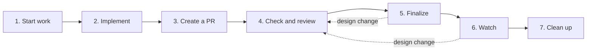
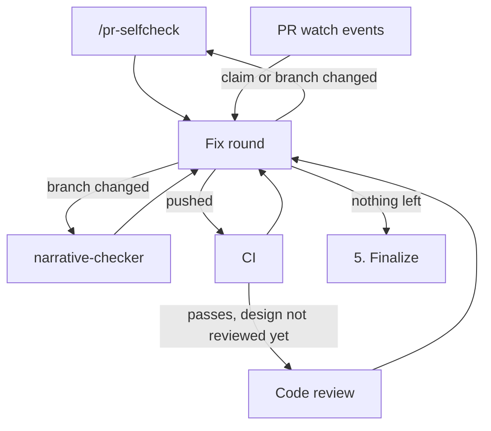

# Git Workflow

Standard git/GitHub workflow for all projects.
Follow each step in order. Skip a step only when its precondition is
structurally absent (e.g., no PR exists yet).

Prerequisites: the `agynio/gh-pr-review` gh extension (the Watch step's
review threads), the `pr-review-toolkit` plugin (the Check and review
step), and the `pr-watch` plugin (the Create a PR step onward).

## Flow

A design change in a later step returns to Check and review.

## Supporting files

- [pr-reaction.md](pr-reaction.md) — bot-versus-human targeting for PR
  events, whether an event is answered by a reply or a fix push, which
  channel a reply goes to, and thread resolve
- [implementer-dispatch.md](implementer-dispatch.md) — branch setup,
  brief contents, what a dispatch does by default, what to do when it
  returns, isolation, and handback bounds for the `implementer`
  subagent

## Principles

- Every step of a single workflow run is pre-authorized by the user who
  initiated the task. Run every step, continuously, and report results
  at the end
  - Pause only when blocked by an error or ambiguity, or when the user
    named a stopping point ("stop after creating the draft PR", "skip
    the code review for this PR", "no PR watch")
  - While a PR watch runs, a pause on an error or ambiguity that
    blocks the run stops the watch through the `pr-watch:watch` skill
    and starts it again on the user's next message, with the final
    message before the pause saying so, since the reply arrives in the
    session while each line of an unattended watch wakes it for a
    re-fetch and a report
    - The restarted watch takes what already exists as seen, so each
      comment, review, and unresolved review thread that its
      `WATCHING` re-fetch shows as newer than the pause goes through
      [pr-reaction.md](pr-reaction.md) as if its line had printed
    - A PR that merged or closed in between prints its `STATE:` line
      on the restart, which the Watch step's exit conditions act on
    - Four pauses keep the watch running, since the run goes on
      reacting to the PR's events during them: the Finalize step's
      hand-off for the ready flip, its hold on an open point, the
      fix-push cap's wait, and a human-authored event surfaced under
      [pr-reaction.md](pr-reaction.md)
  - A small diff, a documentation-only change, and personal-project
    scope are signals for weighing a finding within a step; whether
    the step runs is not a judgment they reach
  - Flipping the PR from draft to ready for review is the user's
    action, since marking a PR ready can request reviewers such as code
    owners at once, and a PR left in draft gives the user the first look
    - A loaded rule that assigns the flip to the agent for this PR
      hands it to the agent, except while the Finalize step holds the
      PR in draft on an open point
- Never create or edit files on the default branch. Always move into the
  worktree (or feature branch) first. Creating files before branching
  leads to redundant copy-and-delete work.
- Never modify commits that have already been pushed
- Fix-push cap: stop autonomous fixes after 5 for this PR in this
  session, counting every fix push made in any step and every
  `/pr-selfcheck` re-run that follows a body-only fix, since past that
  the fixes are no longer converging on their own. Surface the state and
  wait for a user instruction, answering further events and fixes still
  waiting for a fix round with replies and no push.
- Run a design-change round whenever a design change is made in a fix
  that no upcoming code review will cover, in any step and whatever
  finding, event, or failure the fix answers, since no code
  review has judged the new design
  - A fix is a design change when it changes an interface or contract,
    the data flow, the split of responsibilities between files or
    components, or the mechanism the PR chose, or when it leaves the PR
    body's description of the approach untrue
  - A fix that changes none of these, such as an in-place bug fix or a
    reword that keeps the meaning, is a local fix
  - In a rule, skill, or agent definition, a fix that adds or rewords
    handling within the approach the PR body describes is a local fix,
    even though it changes what an agent does; a fix whose description
    would need a new sentence about the approach in the PR body is a
    design change
  - The round: push the committed fixes, update the PR title and body to
    the new design, then run the Check and review step on the new head
  - A round started in the Check and review or Finalize step continues
    into the Finalize step
  - A round started in the Watch step, nested rounds included, ends with
    the Finalize items that update Verification and check acceptance
    criteria, then returns to the Watch step
    - The Watch step's pre-push checks apply to its pushes
  - When a round needs a push the fix-push cap forbids, the round ends
    there and the cap's own handling takes over, including for fixes
    waiting for a fix round
  - Each round starts with a push, so the fix-push cap also bounds how
    many rounds run
- Never end a turn that claims ongoing waiting (delegated fix push,
  CI run, CI rerun, external state change) without an armed event
  source — the completion notice of the background subagent for a
  delegated fix push, `gh pr checks --watch --fail-fast` with
  `run_in_background: true` for a CI run or rerun, and the PR watch
  for review activity and PR state. After every `gh run rerun` or
  other re-kick, re-arm `gh pr checks` before yielding. State what is
  being awaited in the final message before going idle.

## 1. Start work

When the approved plan is several independent PRs, read
[implementer-dispatch.md](implementer-dispatch.md) before the steps
below — it decides whether they run in parallel or sequentially, and the
isolation each one needs.

1. From the main clone, not a worktree, switch to the default branch and
   pull: `git home`
1. Create a worktree and branch (defaults to branching from origin's default branch):
   `git-worktree-create <branch-name>`
   - To branch from somewhere other than origin's default:
     `git-worktree-create <branch-name> <base>`
1. Follow the command shown in the script output to move into the worktree
1. If the project rules explicitly prohibit worktrees, create a branch only:
   `git checkout -b <branch-name>`

Note: `.worktrees/` is covered by the global gitignore.

## 2. Implement

The implementation work for this branch happens here, ending with the
branch committed and pushed. When it is delegated to the `implementer`
subagent, read [implementer-dispatch.md](implementer-dispatch.md) before
writing the brief, and follow it through the handback bound it sets.

When the commit message or PR body will claim an exhaustive
replacement or update ("replaced all X with Y"), run
`git grep -n '<old pattern>'` before committing and confirm zero
remaining matches — `replace_all` misses occurrences that differ in
formatting or indentation.

## 3. Create a PR

As soon as a PR exists, start the PR watch through the `pr-watch:watch`
skill, so that a bot comment or a failing check on the draft reaches the
session during the steps below. The re-fetch on its `WATCHING` line
covers what arrived before the watch began.

- For a PR an implementer opened or found, start it on the implementer's
  progress message that gives the URL, or on its completion report when
  no such message came
- When the watch fails to start, report that and go on, since the
  Finalize step checks the watch again
- Start none when the user named "no PR watch" or a stopping point at
  the draft PR, since an event would otherwise resume work past that
  point

For a PR the implementer opened, read
[implementer-dispatch.md](implementer-dispatch.md) first and apply its
`When it returns` steps, since the body it left is a placeholder.

Then invoke the `pr-issue-writing` skill, which carries the
properties a title and body are judged against and the commands that
write them. This holds wherever the workflow writes or edits a title or
body, including the Finalize updates.

Proceed to the Check and review step once the PR exists and its URL is
displayed.

## 4. Check and review

Four checks leave the branch and the working tree alone: three start at
once, and the code review joins once CI passes. All of them and the PR
watch's events feed one fix round, which repeats until nothing is left
to fix. A design-change round restarts this step.

Launch all three in a single assistant message so they execute concurrently:

- `/pr-selfcheck <PR number>` — PR body presentation review
- the `narrative-checker` agent — process-record narration in the comments
  and Markdown prose the branch added. Pass it the repository path and
  the branch name, and nothing else
- `gh pr checks --watch --fail-fast` — CI monitoring. Run with
  `run_in_background: true`

After any push, and after a watch exits with checks still pending,
re-arm `gh pr checks --watch --fail-fast`.

When `gh pr checks` exits 1 with `no checks reported`, re-run it once
after `/pr-selfcheck` and the `narrative-checker` agent report, since
checks may not have registered against a new head yet. A second
`no checks reported` counts as no check running on this head and as CI
passing in this step, so the code review starts and the Finalize
conditions can hold.

As soon as CI passes on a design no code review has judged, launch the
code review, unless the user skipped it for this PR. Do not wait for the
other two, since no check changes the branch or the working tree:

- `/pr-review-toolkit:review-pr code comments tests errors types` —
  multi-agent code review (CLAUDE.md compliance, bug detection, error
  handling, test coverage). These aspects leave out `simplify`, which
  edits in place. Reports findings in the conversation, does not post
  PR comments.

Fix a self-review finding that only touches the PR body as soon as it
reports, since `gh pr edit` changes neither the branch nor the working
tree, and leave its re-run to the fix round's last step, so the round's
other body edits share it.

### PR events

The Watch step's items govern each line the PR watch delivers before
the Finalize step hands the PR to review, and during a design-change
round, with the differences below. A run that enters the workflow at
this step starts the watch first.

- A fix an event asks for waits for a fix round, so it lands in that
  round's one push
  - One asked for in the Finalize step returns the run to a fix round,
    so the conditions for leaving this step hold again before the PR is
    handed to review
- A reply goes out at once, since it changes neither the branch nor the
  working tree
- A `CHECK` line and the `gh pr checks` monitoring can report one
  failure, which makes one fix
  - While an implementer works, a `CHECK` line waits for its completion
    report, since the implementer can take that failure itself

### Fix round

Run a fix round once every launched check has reported, so the fixes
land in one push. A code review waits for CI, so a CI failure leaves
none to wait for.

1. Fix every self-review "Fix" item. Each "Note" is either acted on too,
   or declined in the assistant message with the reason — a Note passed
   over in silence leaves the user unable to see the call was made
1. Apply what the `narrative-checker` agent reported: each rewrite or
   removal, with an escalated line's rationale moved into the PR body
   first. In a rule, skill, or agent definition, apply one only when it
   keeps the instruction's meaning, and otherwise decline it in the
   assistant message with the reason
1. Fix issues found by the code review, CI failures
   (`gh run view --log-failed`), and what PR events ask for, and commit
   every fix so far. A dispatched implementer whose handback is unused
   takes the CI failure instead, under the push step below
1. When any of the fixes is a design change that no upcoming code review
   will cover, start the design-change round from Principles and skip
   the remaining steps below
1. Push the fixes in one push. An implementer taking a CI failure pushes
   them instead: hand the failure back under the handback bound in
   `implementer-dispatch.md`, wait for its completion report, and push
   anything it left
1. Re-run `/pr-selfcheck` once, here, when the branch changed or a body
   edit added, changed, or removed a claim (a fact, figure, decision, or
   scope) since its last run, and the `narrative-checker` agent when the
   branch changed, then run the next fix round on what they, CI, and any
   code review report
   - Any other body edit, such as a rewording, a split, or a reorder,
     needs none, whatever finding or Note it answers, since the claims
     `/pr-selfcheck` judged stand as it judged them; a prose defect such
     an edit brings in is left to the human reviewer

Go to the Finalize step when all of these hold:

- CI passes and every launched check has reported
- A code review has judged the design, unless the user skipped it
- No `/pr-selfcheck` re-run is due under the fix round's last step, and
  the last `narrative-checker` read the current head
- No finding, Note, escalation, PR event, or unpushed commit is left
  unhandled

The code review runs again only in a design-change round. After local
fixes, the `narrative-checker` re-run catches narration in the new
comments and prose, and the `/pr-selfcheck` re-run catches drift between
the body and the diff.

## 5. Finalize

Bring the PR into a state where a human reviewer can act on it:

1. Reflect actual verification in the PR body. Update the body to
   describe what was confirmed, with evidence (HTTP status, Location
   header, Lambda runtime value, log excerpt, command output summary,
   etc.) so each claim is auditable later. If the body has checkbox
   items, sync `[ ]` to `[x]` as each item's condition is confirmed;
   if not, edit the Verification section text directly. Items still
   pending stay as `[ ]` (or noted explicitly as pending).
1. Confirm acceptance criteria are met. Cross-check the PR body and
   any linked issue against the actual change. If something is unmet,
   either address it or call it out as out-of-scope / follow-up. When
   addressing it makes a design change, start the design-change round
   from Principles.
1. Settle each point the PR would leave a reviewer to judge, check, or
   confirm in the author's place, since it marks investigation,
   verification, or an experiment the run has not done: do that work
   and write the result into the PR body, or move the point out of this
   PR as the item above does
   - A point that work cannot settle, such as the user's preference,
     stays open for the hand-off item below
   - Pending verification items with their reason, user-owed `- [ ]`
     items, and results the project's rules leave to use after merge
     are checks, not points
1. Unless the user named "no PR watch", confirm through the
   `pr-watch:watch` skill that the PR's watch runs before the PR leaves
   draft, and start it again when `pr-watch list` omits the PR.
   `READY_FOR_REVIEW` is itself a watched event, so a watch started
   after the ready flip can never observe it.
   - When the watch fails to start, or `pr-watch list` exits 1 because
     no watcher runs, carry that into this step's report
1. Then, in the same turn, hand the PR to review:
   - While a point stays open, leave the PR in draft whoever holds the
     flip, report each point with what would settle it, and continue
     into the Watch step; once the user's answer settles it or the user
     sends the PR to review as it stands, run this item again
   - When a loaded rule assigns the ready flip to the agent for this
     PR, run `gh pr ready <PR number>` in a later tool call, then
     continue into the Watch step
     - A flip before the watch's `WATCHING` line may not report as
       `READY_FOR_REVIEW`, and the re-fetch on that line shows it
   - Otherwise surface this step's completion, before handing control back,
     so the user can decide whether to mark the PR ready for review,
     and run `gh pr ready` only when the user asks for it

Update incrementally as conditions are confirmed (e.g., after CI
passes, after apply / deploy succeeds, after post-deploy
verification with `curl`, `aws logs tail`, etc.).

## 6. Watch

The PR watch delivers one notification line per actionable change and
stays silent in between, across turns. Start it here through the
`pr-watch:watch` skill when the run entered the workflow at this step.
The skill governs the lines about the watch itself, such as
`WATCH_ERROR`; this step reacts to the PR's events, in the steps before
it too, where the Check and review step's PR events section adds its
differences.

1. Each event line names the PR and carries an `<EVENT>` with GitHub's
   own field values. The steps below cover the events with a fixed
   procedure; read any other line and judge from what it says. The
   `pr-watch:watch` skill documents the full set.

1. Re-fetch detail on each event, adding `-R <owner>/<repo>` from the
   line when the PR is in another repository, with:
   - `gh pr view <number> --json state,isDraft,reviewDecision,latestReviews,reviewRequests,statusCheckRollup,comments,updatedAt,mergedAt,headRefName`
   - `gh run list --branch <headRefName> --json databaseId,name,status,conclusion,createdAt,headSha,workflowName --limit 20`
   - review threads: the listing in `pr-reaction.md`'s Step 1, which
     carries the flags each use needs

   The notification is not a user reply — keep working.

1. Before any push:
   - Verify the current branch matches the PR's `headRefName`.
   - `git fetch` and confirm local HEAD is still ahead of
     `origin/<branch>` (no manual push in between).
   - Skip the push if either check fails; surface the conflict to the
     user.

1. Read [pr-reaction.md](pr-reaction.md) on the first watch event,
   before any reply, resolve, or push, and react under it — it governs
   what the `[BOT|USER]` label settles for each event type

1. `CHECK`: `gh pr checks` links the failing check. For an Actions job,
   `gh run view --log-failed <databaseId>` from `gh run list` reaches the
   failed steps, which a conclusion like `cancelled` or `timed_out` does
   not have. Fix and push under the same pre-push checks. When the
   failing check is an Actions job, a dispatched implementer built this
   PR, and its handback is unused, hand the failure back to it instead
   under the handback bound in `implementer-dispatch.md`, and push
   anything it left under the same pre-push checks. When the fix
   is a design change, that push opens the design-change round from
   Principles.

1. Exit conditions:
   - A `STATE: MERGED` or `STATE: CLOSED` event with no `STATE: OPEN`
     after it ends any step or design-change round still running, with
     an implementer working on the branch stopped first, and the two
     items below apply.
   - `STATE: MERGED` → run the Clean up step.
   - `STATE: CLOSED` without merge → skip cleanup.
     - A `STATE: OPEN` after it means the PR was reopened and the watch
       goes on, so keep watching.
   - A watch the `pr-watch:watch` skill reports as stopped and not
     restarted → claim no ongoing wait on that PR.
   - Session ends → the watch stops with it; the `pr-watch:watch` skill
     covers what a resumed session reports.

1. Conflict handling:
   - Manual user push during the watch: acknowledge on the next event,
     keep watching. Do not revert or duplicate.
   - New user instruction superseding the watch: stop it through the
     `pr-watch:watch` skill, prioritize the user request.

`PushNotification` only for events that change what the user would do
next (merge, or "needs human attention" after the fix-push cap). Skip
routine CI / comment events.

## 7. Clean up

After the PR is merged (or the task is fully done):

1. Move back to the repository root:
   `cd <repository root>`
1. Run `git home`, so that the local default branch holds the merge;
   `git cleanup` judges branches against it without fetching.
   - Skip this step and the next while the working tree has uncommitted
     changes, since the switch in `git home` would carry them onto the
     default branch, and say that cleanup was skipped
   - When `git home` fails, still run the next step and report the
     failed pull
1. Run `git cleanup` once.
